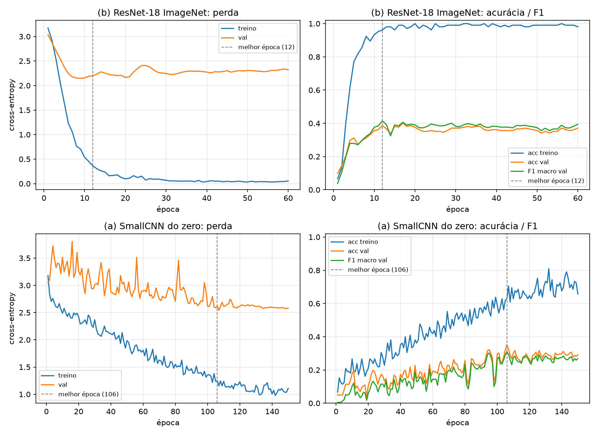
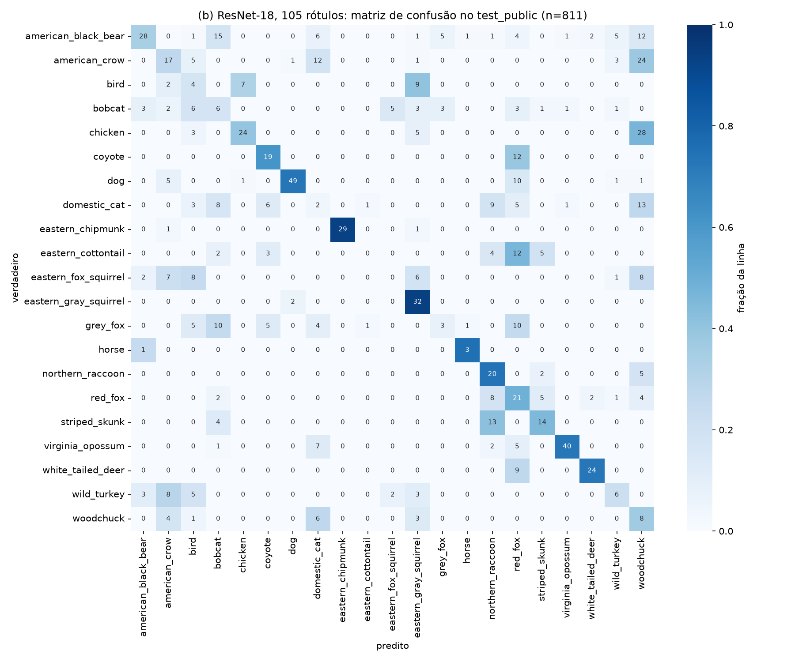

# Parte 0 — O piso

Treino supervisionado **só com `rotulos_5.csv`** (105 imagens, 5 por classe). A época é escolhida
pelo F1 macro no `val` (202 imagens); o `test_public` (811 imagens) é avaliado **uma única vez**, com
os pesos da época escolhida.

## Configuração

Comum às duas versões (`src/train.py`): entrada retangular 224×320 (as imagens têm 512 de largura e
proporção 0,53–0,72), normalização ImageNet, aumentação de treino (RandomResizedCrop com escala ≥ 0,5,
flip horizontal, ColorJitter, RandomGrayscale 0,2 por causa das imagens infravermelhas noturnas),
batch 32, AdamW (weight decay 0,05), warmup linear de 3 épocas + cosseno, bf16, seed 0.

| | (a) SmallCNN do zero | (b) ResNet-18 ImageNet |
|---|---|---|
| modelo | `SmallCNN` (`src/models.py`), pesos aleatórios | `resnet18.tv_in1k` (timm), fine-tuning completo |
| parâmetros | 2.359.285 | 11.187.285 |
| lr | 1e-3 em tudo | 1e-3 na cabeça, 1e-4 no backbone |
| épocas | 150 | 60 |

```bash
uv run python src/train.py --model smallcnn --budget 5 --epochs 150 --name p0a_smallcnn
uv run python src/train.py --model resnet18.tv_in1k --budget 5 --epochs 60 --name p0b_resnet18
uv run python src/plots_part0.py   # figuras em figures/
```

## Resultados

| versão | melhor época (val) | val F1 | **test F1 macro** | **test acc** |
|---|---|---|---|---|
| (a) SmallCNN do zero | 106 / 150 | 0,311 | **0,210** | **0,250** |
| (b) ResNet-18 ImageNet | 12 / 60 | 0,415 | **0,415** | **0,430** |

Referências: acaso entre 21 classes ≈ 0,05 de F1; teto do monitor (todos os rótulos) = 0,686.

**O pré-treino no ImageNet praticamente dobra o F1** (0,21 → 0,415) com os mesmos 105 rótulos. Com
tão poucos dados, quase todo o desempenho vem das features aprendidas antes, não das nossas imagens.

**val × test na SmallCNN (0,311 × 0,210).** Dois motivos: o val é pequeno (~10 imagens por classe),
e escolher o máximo entre 150 avaliações ruidosas favorece um pico de sorte. Na fase final o val F1
oscila em ~0,25–0,27, mais perto do test. No ResNet o problema não aparece (0,415 nos dois).

## Curvas de treino e validação (`figures/p0_curvas.png`)



**(b) ResNet-18: começa a decorar entre as épocas 8 e 10.**
- A val loss atinge o mínimo (~2,15) por volta da época 9 e depois sobe (~2,4 na época 24),
  enquanto a perda de treino continua caindo até ~0,05.
- A acurácia de treino passa de 90 % na época 8 e chega a ~100 % na 13: as 105 imagens foram decoradas.
- O val F1 tem pico na época 12 (0,415) e depois **estaciona** em 0,36–0,40 em vez de despencar.
  A val loss sobe porque a rede fica **superconfiante** nos erros, sem mudar muito a classe que
  escolhe. Esse mesmo excesso de confiança é o que leva ao colapso do FixMatch na Parte 1
  (ver `docs/parte1_fixmatch.md`).

**(a) SmallCNN: não decora, aprende devagar.** A perda de val cai lentamente durante todo o treino e
a acurácia de treino só chega a ~70 % nas 150 épocas. Uma rede do zero, com dropout e aumentação, mal
consegue ajustar as 105 imagens. O val oscila muito de uma época para outra (202 imagens).

## Matriz de confusão de (b) no test_public (`figures/p0b_confusao.png`)



Cores normalizadas por linha (diagonal = recall de cada classe), números = contagens. O test é
desbalanceado (82 ursos, 4 cavalos), por isso a leitura é por fração.

**Classes bem resolvidas** (recall > 70 %): eastern_chipmunk 29/31, eastern_gray_squirrel 32/34,
virginia_opossum 40/55, dog 49/67, white_tailed_deer 24/33.

**Classes quase nunca acertadas:** eastern_cottontail 0/26 (vai para red_fox), eastern_fox_squirrel
0/32 (espalha entre bird, woodchuck, crow e gray_squirrel), grey_fox 3/39 (vai para bobcat e red_fox),
além de woodchuck e wild_turkey com recall baixo.

Os erros são de dois tipos:

1. **Confusões entre animais parecidos**, plausíveis numa foto noturna de armadilha: skunk → raccoon
   (13), coyote → red_fox (12), grey_fox → bobcat / red_fox, fox_squirrel → gray_squirrel,
   urso → bobcat (15).
2. **Classes que atraem previsões demais.** O modelo prevê **woodchuck 103 vezes** (22 reais) e
   **red_fox 91 vezes** (43 reais). Os maiores erros, **chicken → woodchuck (28)** e
   **crow → woodchuck (24)**, não têm semelhança visual nenhuma. Hipótese: atalho de **fundo**, ou seja,
   alguma imagem rotulada de woodchuck compartilha câmera/cenário com chicken e crow. É o mesmo tipo de
   atalho visto nos pseudo-rótulos da Parte 1 e um candidato para o Grad-CAM da Parte 3.

**horse** acerta 3 de 4: com só 4 imagens no test, o F1 dessa classe é quase ruído, mas pesa no F1
macro tanto quanto o urso.
