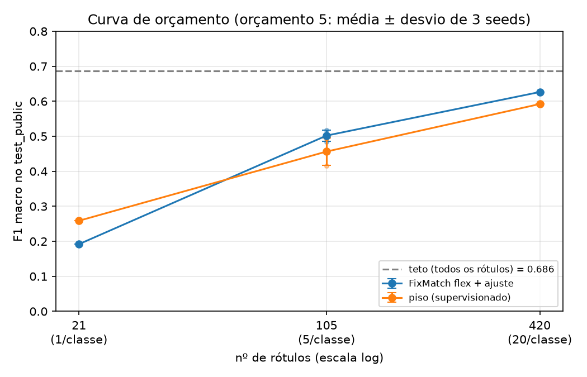
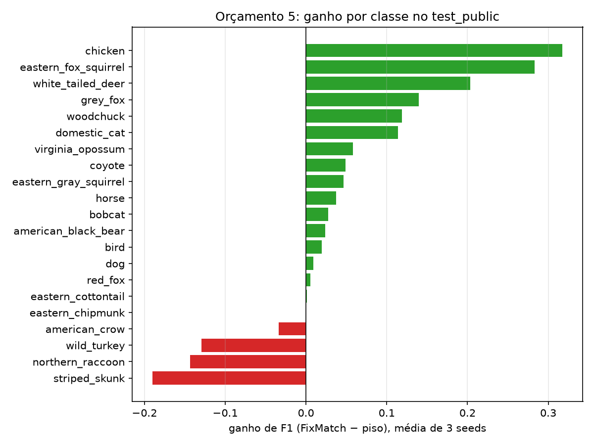

# Parte 2 — Curva de orçamento

Piso (receita da Parte 0b) e método (FixMatch `flex` + ajuste anticolapso, hiperparâmetros
escolhidos no val na Parte 1) com 1, 5 e 20 rótulos por classe. No orçamento 5, 3 seeds.
A seed muda a inicialização da cabeça, a ordem dos batches e as aumentações; o conjunto
rotulado (`rotulos_K.csv`) é sempre o mesmo. Época/passo escolhidos no val; test avaliado uma vez.

```bash
bash run_part2.sh                     # treina os runs que faltam (pula os que já existem)
uv run python src/part2_curve.py      # curva_orcamento.csv + figuras + ganho por classe
```

## Resultados (test_public)

| orçamento | nº rótulos | piso F1 | FixMatch F1 | ganho | piso val F1 | FixMatch val F1 |
|---|---|---|---|---|---|---|
| 1  | 21  | 0,259 | 0,192 | **−0,067** | 0,211 | 0,232 |
| 5  | 105 | 0,456 ± 0,039 | 0,502 ± 0,016 | **+0,046** | 0,416 | 0,409 |
| 20 | 420 | 0,592 | 0,626 | **+0,034** | 0,603 | 0,676 |
| teto | todos | 0,686 | | | | |

Seeds individuais no orçamento 5 (test F1): piso 0,415 / 0,492 / 0,462; FixMatch 0,485 / 0,517 / 0,505.
Números completos em `curva_orcamento.csv`; figura em `figures/p2_curva_orcamento.png`.



**Leitura:**
- **Orçamento 5:** o FixMatch ganha +0,046 de F1 em média e tem **menos variância** entre seeds
  (desvio 0,016 contra 0,039). Recupera ~20 % da distância piso → teto (0,230).
- **A variância do piso é grande.** A seed 0, usada nas Partes 0 e 1 (0,415), foi a pior das três;
  as outras deram 0,46–0,49. Comparações com uma seed só no orçamento 5 são frágeis.
- **val × test discordam no orçamento 5:** no val, as médias são praticamente iguais
  (0,409 × 0,416); só no test o FixMatch fica à frente. Com 202 imagens no val, a diferença está
  dentro do ruído.
- **Orçamento 1: o FixMatch piora** (0,192 × 0,259). Com 1 rótulo por classe o pseudo-rotulador é
  muito ruim (val F1 ~0,2), e treinar nos próprios pseudo-rótulos amplifica os erros (viés de
  confirmação); o melhor passo foi cedo (400). Aqui o val não avisou: ele dava vantagem ao FixMatch.
- **Orçamento 20:** ganho de +0,034 no test, e aqui o val concorda com folga (0,676 × 0,603).
  Recupera ~36 % da distância restante até o teto.
- Resumo: o semi-supervisionado ajuda quando o modelo inicial já é razoável (≥ 5 rótulos por
  classe); com 1 rótulo, os pseudo-rótulos são ruins demais.

## Ganho por classe no orçamento 5 (média de 3 seeds)

Figura `figures/p2_ganho_por_classe.png`; números em `analysis/p2_ganho_por_classe.csv`.



- **Ganharam mais:** chicken (+0,32), eastern_fox_squirrel (+0,28), white_tailed_deer (+0,20),
  grey_fox (+0,14), woodchuck (+0,12), domestic_cat (+0,11).
- **Não ganharam nada:** eastern_chipmunk (já em 0,97 no piso), eastern_cottontail, red_fox, dog.
- **Pioraram:** striped_skunk (−0,19), northern_raccoon (−0,14), wild_turkey (−0,13), american_crow (−0,03).

Skunk e raccoon são exatamente o par confundido na Parte 0 (13 skunks previstos como raccoon) e
raccoon tem precisão 0 nos pseudo-rótulos aceitos (Parte 1, seção 3): o FixMatch **reforça uma
confusão que já existia**. As classes que ganham são as que o piso já acertava em parte e cujos
pseudo-rótulos têm boa precisão (chicken 0,97, deer 1,00).

## Notas de execução

Os runs do piso levam 1–3 min. Os do FixMatch falharam na 1ª tentativa com 2 workers por falta de
RAM (`DefaultCPUAllocator: not enough memory`) e terminaram na 2ª, com 1 worker (~27 min cada).
